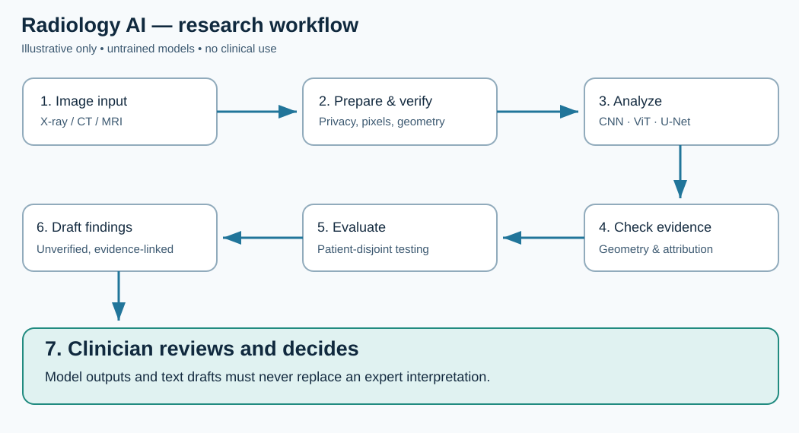
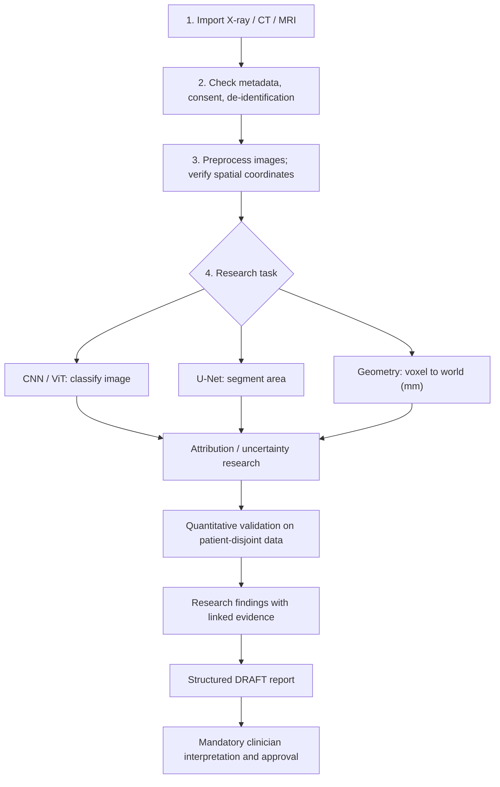

# Radiology Diagnosis — Deep Learning & Geometry Research

> **Research prototype — NOT a medical device, diagnosis system, or clinical decision support product.** All demonstrations are synthetic or untrained. No claims of diagnostic accuracy are made.

**End-to-end research architecture** for medical image representation, CNN / Vision Transformer classification, U-Net segmentation, spatial geometry, multimodal late fusion, explainability, quantitative evaluation and **clinician-reviewed** structured report drafts.

## A simple picture: what happens?





**In everyday language:** put in a permitted image; check image quality and spatial metadata; use different models to test whether a pattern exists or outline an annotated region; inspect what the model responds to; evaluate on patients it never saw; create an **unverified** text draft that a qualified clinician must interpret. A saliency heatmap is *not* a lesion mask, and a score is *not* a diagnosis.

## Project status (implementation vs roadmap)

| Component | Current status |
|---|---|
| 2-D image loader; DICOM pixel reader; NIfTI 3-D reader | Research prototypes |
| Patient-wise grouping, reproducible splits | Implemented |
| ResNet18 CNN, ViT-B/16 classification heads | Implemented, untrained |
| 2-D U-Net segmentation; Dice/IoU | Implemented, untrained |
| Image + tabular late fusion | Implemented, untrained |
| Voxel-to-world geometry / affine transforms | Implemented |
| Gradient and occlusion attribution | Implemented; not clinically meaningful by itself |
| Binary metrics | Implemented |
| Report formatting + evidence-reference check | Research-only **draft** utilities |
| Trained models, external validation, 3-D learning, validated generative reports | **NOT provided** |

## Quick start

```bash
git clone https://github.com/halim-abdul/Radiology-Diagnosis-Deep-Learning.git
cd Radiology-Diagnosis-Deep-Learning
python -m venv .venv
# Linux/macOS: source .venv/bin/activate
# Windows: .venv\Scripts\activate
pip install -e '.[test]'
pytest -q
```

Optional medical image formats: `pip install -e '.[medical]'`.

### Try the models (random weights, test only)

```python
import torch
from radiology.models.cnn import make_resnet
from radiology.models.unet import UNet2D
from radiology.geometry.overlap import dice_score

print("CNN logits:", make_resnet()(torch.randn(1,3,224,224)).shape)
print("U-Net mask logits:", UNet2D()(torch.randn(1,1,64,64)).shape)
print("Perfect synthetic overlap:", dice_score([1,0,1], [1,0,1]))
```

## Ten illustrated notebooks

Each notebook creates plots or inspects numerical model outputs. Execute locally to render the plots; no medical scans or validated results are bundled.

| # | Notebook | Learning goal |
|---|---|---|
| 01 | [Introduction to images](notebooks/01_image_introduction.ipynb) | Synthetic intensity phantom |
| 02 | [Preprocessing](notebooks/02_preprocessing.ipynb) | Image display and histogram |
| 03 | [Patient splits](notebooks/03_patient_splitting.ipynb) | Leakage prevention |
| 04 | [CNN baseline](notebooks/04_cnn_baseline.ipynb) | ResNet image logits |
| 05 | [Vision Transformer](notebooks/05_vision_transformer.ipynb) | ViT architecture |
| 06 | [U-Net and localization](notebooks/06_unet_segmentation.ipynb) | Overlay synthetic masks, Dice |
| 07 | [Geometry](notebooks/07_coordinate_geometry.ipynb) | Voxel-to-world affine |
| 08 | [Explainable AI](notebooks/08_explainable_ai.ipynb) | Random-model sensitivity map |
| 09 | [Evaluation](notebooks/09_evaluation.ipynb) | Binary ROC demonstration |
| 10 | [Safe draft reports](notebooks/10_report_safety.ipynb) | Human approval gate |

## Research modules

```text
src/radiology/
├── data/          # manifests, grouping, PNG/JPEG, DICOM, NIfTI
├── models/        # ResNet, ViT, 2D U-Net, tabular late fusion
├── training/      # epoch loop, binary metrics, random seeds
├── geometry/      # physical-space affine, mask overlap
├── explain/       # gradient saliency and occlusion
├── reports/       # evidence references and structured drafts
└── safety/        # PHI logging guard (not full anonymization)
notebooks/         # 10 executable Jupyter research tutorials
docs/              # study design, methodology, safety, roadmap
tests/             # shape, split, mask geometry, draft invariants
assets/workflow.svg
```

## Documentation (ten topic READMEs)

[Documentation index](docs/README.md) · [Data](docs/data/README.md) · [Models](docs/models/README.md) · [Training](docs/training/README.md) · [Geometry](docs/geometry/README.md) · [Explainability](docs/explainability/README.md) · [Reports](docs/reports/README.md) · [Evaluation](docs/evaluation/README.md) · [Safety](docs/safety/README.md) · [Ethics](docs/ethics/README.md) · [Research roadmap](docs/research/README.md) · [Notebooks](notebooks/README.md)

## Research methods handbook

The [research handbook](docs/handbook/01_research_question.md) contains focused study notes on cohort design, leakage prevention, volumetric geometry, model assumptions, and quality assurance. Each note separates scientific motivation from implemented results.

## Professional research agenda: imaging × mathematics × geometry

- **Multiscale Riemannian geometry:** robust physical-coordinate registration, volumetric manifolds and curvature-aware representations.
- **Spectral methods:** Laplace–Beltrami spectra, heat kernels, diffusion operators, graph construction from anatomical structures and spectral stability.
- **Topology-aware segmentation:** persistent homology and anatomical connectivity priors.
- **Multimodal learning:** paired images / reports with explicit grounding, missing-modality handling and adversarial label-shortcut audits.
- **Validation:** multicenter external testing, group-aware confidence intervals, uncertainty, calibration and clinician reader studies.

These are **proposed investigations**, not completed or benchmarked experiments.

## Reproducibility and clinical boundaries

No medical datasets, trained weights or patient-level performance are shipped. Use institution-approved data, explicitly record consent / licensing and data provenance, and never commit identifying information. Keep all test patients out of training. Inspect orientation / spacing for volumetric analyses. The DICOM preprocessing snippet is basic and does **not** constitute full de-identification. All reports require verification by qualified professionals and must never be automatically inserted into clinical systems.

**License:** see the existing [LICENSE](LICENSE). Third-party datasets and weights have separate licenses.
